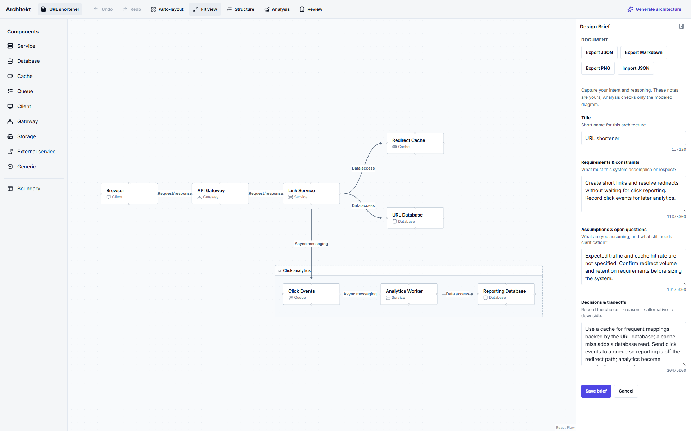
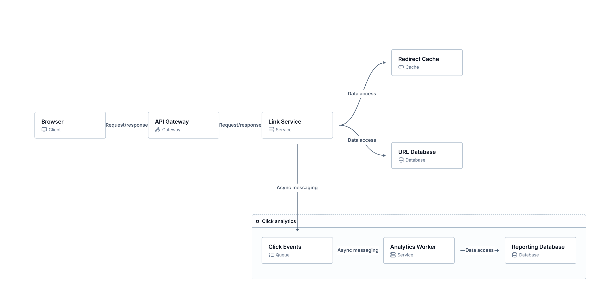

# Architekt

Architekt is a personal software-engineering project I built to explore how a system-design workbench can combine structured modeling, deterministic analysis, and grounded AI reasoning.

## Why I built it

System design is often captured in static diagrams or discussed in free-form AI conversations. I wanted to build a place where the architecture remains structured and editable, while AI helps a person explore possibilities without becoming the source of truth. That constraint shaped the domain model, the review flow, and the separation between facts the graph can prove and questions worth asking about it.

## From idea to architecture

1. **Describe or speak a system.** A typed prompt or an edited voice transcript enters the same generation path. The result is a proposal with components, directed connections, assumptions, and a summary; nothing changes until the user reviews and applies it.
2. **Edit the diagram.** Components have modeled kinds, connections have semantic kinds, and generic boundaries group components. Manual edits, layout, and Undo/Redo remain available after Apply.
3. **Record the reasoning.** The Design Brief holds user-authored requirements, assumptions, open questions, decisions, and tradeoffs alongside the diagram.
4. **Inspect, then question.** Deterministic Analysis reports structural and semantic observations. Grounded Review separately selects modeled evidence and exact saved Brief excerpts to frame conditional tradeoffs and focused questions. Neither feature edits the architecture.
5. **Take the work elsewhere.** Export canonical V5 JSON for a validated round trip, deterministic Markdown for reading, or a complete-diagram PNG. JSON import previews replacement before a single Apply.

The [prepared URL-shortener architecture](docs/demo/url-shortener.architekt.json) runs through this workflow. Its [Markdown artifact](docs/demo/url-shortener.md) and [PNG artifact](docs/screenshots/portable-diagram.png) were exported from Architekt. The diagram models click reporting off the redirect path; the Brief records the assumptions and tradeoffs behind that choice.

## Engineering highlights

- **A domain model independent of the canvas.** Immutable `ArchitectureGraph` owns components, connections, boundaries, and their invariants. React Flow renders a derived view; positions are canonical editor data, while measurements, selection, and viewport state remain transient. Meaningful edits use snapshot history rather than renderer state.
- **A guarded AI boundary.** Generation and Review use provider-independent application contracts. Provider output is untrusted: it is validated and resolved before it can become a proposal or displayed review. Apply is an explicit, single history transition.
- **Facts separated from interpretation.** Analysis computes observations from the graph without AI. Grounded Review uses snapshot-local evidence aliases, formats modeled facts deterministically, and accepts only exact excerpts from the committed Design Brief as stated context. Its tradeoffs and questions remain advisory.
- **Asynchronous work that respects the editor.** Cancellation, operation versions, and review snapshot comparisons protect against stale responses. Browser microphone recording has explicit permission, Stop/Cancel, cleanup, and editable-transcript stages; audio and transcript drafts do not enter document history or persistence.
- **Portable output without hidden state changes.** Strict V1–V5 restoration protects canonical data. JSON is the machine format; Markdown and stable-light PNG are derived local exports. PNG captures the full diagram rather than the current viewport and proportionally reduces resolution when browser limits require it.
- **Protected paid AI for a public demo.** Manual editing and local exports remain available without an invite. Generate, Transcribe, and Review are behind invite-derived sessions and shared atomic Redis admission, with limits and a global switch before provider construction. The final deployed Vercel/Redis/HTTPS acceptance gate is still pending.

## Technical design

The data flow is `validated input → domain/editor operation → canonical document → derived renderer`. AI proposals stay transient until explicitly applied; reviews remain transient and never mutate the graph. The document combines graph structure, node positions, and the committed Design Brief. History and V5 persistence exclude renderer measurements, selection, viewport, form drafts, Voice state, and AI review state.

I used **TypeScript, Next.js 16, React 19, React Flow, Dagre, and Tailwind CSS 4** for the Workbench; **Vitest and Playwright** for domain and browser verification; and server-side **OpenAI** integration with an atomic **Redis** admission layer for paid routes. The [architecture notes](ARCHITECTURE.md) cover ownership boundaries and tradeoffs in more detail.

## Validation and evaluation

The project has over 1,000 automated unit tests covering domain invariants, history, persistence, analysis, imports/exports, AI validation, and paid-route admission. Production-build Playwright tests exercise the Workbench and controlled provider flows. I also evaluated generation and Grounded Review with live model requests, tested Voice with a physical microphone on Windows Chrome, Edge, and Brave, and inspected actual JSON, Markdown, and PNG downloads across those browsers. Atomic Redis admission was exercised against an isolated managed test store; deployed production acceptance remains a separate gate. These checks cover failure and recovery paths as well as the happy path, but they are not a claim of production reliability.

The dated [generation](docs/evaluations/ai-generation-2026-10-01.md), [Grounded Review](docs/evaluations/grounded-review-2026-10-11.md), [Voice](docs/evaluations/voice-to-architecture-2026-10-03.md), and [Portable Documents](docs/evaluations/portable-documents-2026-10-04.md) reports record the prompts, browser checks, limitations, and model decisions.

## Demo artifacts

The public live-demo URL will be added after the deployed acceptance gate passes. For now, the [three-minute demo script](docs/demo/demo-script.md) pairs with the [editable URL-shortener JSON](docs/demo/url-shortener.architekt.json), its [readable Markdown](docs/demo/url-shortener.md), and this diagram exported by the application:

## Current status and limits

Architekt is a personal portfolio project, not packaged as a general-purpose self-hosted product. The Workbench is implemented, but the public deployment has not passed its final Vercel/Redis/HTTPS gate; paid AI in that demo is intended to be invite-protected.

The Design Brief is user-authored context, not verified architecture fact, and Grounded Review is advisory rather than a correctness verdict. Dense diagrams can be hard to read. Voice v1 is verified for English with a physical microphone on Windows desktop Chrome, Edge, and Brave; mobile microphone behavior, Safari, Firefox, macOS, multilingual transcription, and actual screen-reader speech remain unverified.

For deeper context, see the [product decisions](PRODUCT.md), [interaction design](DESIGN.md), [architecture notes](ARCHITECTURE.md), and [evaluation reports](docs/evaluations/).
